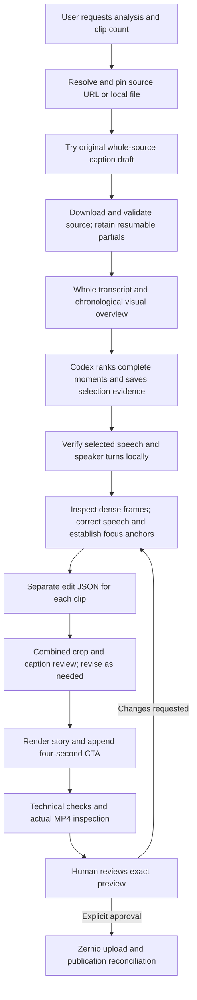

# Performance branch additions (2026-10-15)

These changes are on `performance-optimization`, not main. Existing review, caption/word, full-height crop, CTA and publication approval guards remain enforced.

- `adaptive_sampling.py` selects representative proxy frames from the existing sequential half-second/cut extraction. FAST/SMART share the same implementation and differ only in static/moving sampling intervals. It preserves opening/ending, scene changes, motion witnesses and transcript changes; its 50-frame budget is advisory, never permission to omit a flagged scene. Pixel change is triage, not semantic identity. Whole-source editorial overview remains required.
- `editing_plan.py` compiles existing scene-table specs into a hash-bound `editing-plan.json`, with source, caption IDs/intervals/style fingerprint, camera/cuts and fixed rendering settings. It rejects gaps/unsupported layouts/missing full bounds/invalid word intervals before rendering. `plan-check` is a dry validation command. This does not replace verified-word or crop/motion/pre-render review guards.
- `semantic_analysis.py` is an optional vision-language proposal adapter, disabled unless an endpoint and explicit model/version are configured. It accepts local CPU chat-completion image servers; no local vision model is downloaded by the project. Remote HTTPS requires additional explicit opt-in. It sends selected preview frames and transcript context, validates source/frame hashes, scene schema and visual evidence witnesses, caches responses by relevant inputs/model and requires actual identity inspection. Low-confidence/unavailable/invalid proposals retain stable reviewed framing and request review; no coordinates are inferred from transcript keywords. Models may hallucinate; confidence is not proof. This is assistance, not validated unattended semantic editing.
- `fast_render.py` seeks to one second before the earliest selected source second, then rebases exact video filter trims. Audio remains on a separate original absolute decode/trim input to avoid Opus/Matroska pre-skip shifts. Camera, ASS, FPS, CRF, audio fades and cuts are unchanged. `input_seek=False` remains available for benchmark parity. Real fractional/gapped tests compare all decoded frames and audio sample count/error.
- `RENDER_BACKEND=legacy` remains default: the measured legacy/OpenCV renderer outperformed the direct FFmpeg path on this machine. `direct` is opt-in for careful jobs as well as the existing fast route; revisions that require the existing lossless recovery still use it. `X264_PRESET=fast` remains default; `veryfast` is experimental and must be quality-compared before use. No CUDA or paid provider is required.
- `performance.py` records render wall time/attempts and optional psutil process-tree samples of CPU/RSS if psutil is already installed. Missing psutil yields unavailable metrics, not zero. No new dependency is required. Existing stage/interactive timing remains the total-wall authority. `doctor` checks tools/assets/packages without network or secrets.

The default still requires Codex/operator story selection, source identity review and wording review. Fully unattended student operation is NOT demonstrated. The remaining semantic/review requirement cannot honestly be eliminated just by reducing screenshots. New real-source end-to-end benchmarks and the talking-head/podcast/nature/screen-recording validation matrix remain pending supplied footage/provider setup. No3–5-minute or<10-minute guarantee is made.

See [docs/PERFORMANCE.md](docs/PERFORMANCE.md) for actual measurements and commands.

---

# AUTO CLIPPING — system and editing architecture

Last checked against the local implementation: **15 October 2026**.

### Source-specific review policy and phase timing (latest)

Both careful and fast modes now require a pre-render baseline inspection; the older fast render-first bypass is retired. `review-policy.json` is written per clip with policy/reason, classification, zero-flag check outcome, source/spec binding, changed/flagged-only later rounds and the two-correction cap.

| Source/passage | First-pass policy |
|---|---|
| Reviewed stable dominant presenter or stable single narrator, known non-animated, fixed/face-tracked, confirmed identity/framing, all crop/motion/boundary checks present and passing with zero flags | `stable-baseline-exceptions`: generate and inspect the compact baseline; omit full scene-by-scene first-pass inspection; retain final opening/ending/CTA/flagged samples and existing technical/cut checks |
| Animated/multi-character where identity matters, or real multi-speaker dialogue needing identity review | `identity-full-first-pass`: baseline plus proxy compact sheets covering every scene, moving anchors and flagged witnesses; inspect every first-pass page once |
| Unknown evidence, unstable framing, flags, missing/unverified motion mapping or checks | `full-first-pass` conservatively; flags never silently enable reduced review |

Every later round inspects changed/flagged pages only; previously inspected identical pixel hashes may carry over. Baseline generation never grants inspection or publication approval. Review/render guards check the current source, policy, spec and implementation; both modes sample the actual final MP4. Final encoding, word verification/highlighting, full-height crop, audio, four-second CTA and exact-preview approval remain unchanged.

Use `reel.py phase JOB PHASE --event start|end --round N` before/after actual interactive work: selection_reading, scene_planning, spec_writing, each review_pass, each correction and final_inspection. Clip ledgers `interactive-phases.jsonl` preserve exact observations; parent stage timing names are unique per clip/round, so parallel clips cannot overwrite each other. Correction rounds above two are rejected. Timing commands use the timing lock rather than the media workflow lock and can run during downloads. The operator must mark reasoning/viewing when it happens; Python cannot observe chat thinking and does not fabricate those times.

`timing-report` separately reports interactive wall-time union, between-command intervals, and their interactive overlap. CLI-free time may include background processing too. These are overlapping views of the same timeline, never additive costs. Open phases and residual unrecorded gaps stay visible; no historical stage attribution is invented. Standard command coverage still records CLI time. See AGENTS.md for required phase boundaries and review/correction numbering.

### Current preparation speed changes (15 October 2026)

Standard YouTube `analyze` runs careful editing semantics with an eager-download preparation route. Metadata is obtained once; ordinary full-quality media starts downloading immediately afterward in one bounded local subprocess, concurrently with <=480p proxy, caption draft and selection preparation. It cannot start before format metadata exists. A job-level `download-policy.json` selects sections only at/above `SECTION_DOWNLOAD_MIN_HEIGHT=2160` or above estimated `FULL_DOWNLOAD_MAX_BYTES=1500000000`. Unknown format inventories conservatively select sections. Sections retain the single full-download fallback and no 429 loop. Accepted full files are hash checked on reuse. Metadata including signed stream URLs is passed over stdin, not saved or placed in arguments. The process exits on completion/failure/transfer deadline; there is no hosted worker or standing scheduler.

`selection_draft.py` chooses native uploaded tracks first, otherwise native auto-generated tracks (`en-orig` for the saved test source), never translated/dubbed versions. Auto captions are selection-only and live in a separate per-video/language/duration SHA-256-verified cache. `--fresh-captions` bypasses the shared cache; each run's receipt prevents endpoint repeats. A blocked or incomplete track falls back immediately after validated proxy audio is available to local `SELECTION_DRAFT_MODEL=base` (or tiny), beam1 CPU/int8; known English uses base.en/tiny.en. First use provisions that model locally and reports provisioning separately. That fallback has not yet been speed-benchmarked here because the saved source has usable auto captions. It is never a replacement for selected-passage small/beam5 verification or existing audio anchor checks. Automatic/base draft text cannot lower word confidence through lexical corroboration or supply burned captions. Model loading/checkpoint provenance, cue/word render guards, passage-only diarization policy and all output/approval rules remain.

`motion_check.py` performs cached, source/spec/implementation-bound CPU optical flow on the proxy's reviewed subject regions. It compares motion and crop drift with the actual eased camera, flags motion near story boundaries and lost tracking, and feeds exceptions into preflight/review. It does not automatically infer semantic identity; animation, occlusion and abrupt scale changes can create extra flags. Static full-subject crop safety remains a separate hard check. `COMPACT_PRE_REVIEW=true` generates one baseline sheet (up to eight samples); the source-specific policy above adds all scene pages for animated/identity/uncertain passages, and flagged scene witnesses use stable scene-pair slots. Later inspection remains changed/flagged-only with pixel-hash carry-over. Final inspection requirements and round caps are unchanged. Do not claim less human review time until measured.

CLI command envelopes and between-command intervals now appear in stage timings; the latter mean interactive/idle time, not CPU execution. Mark actual editorial phases explicitly with `stage-mark`. The workflow envelope is excluded from measured coverage so it cannot hide gaps. Older unrecorded time remains visibly unrecorded; command logs permit only a partial retrospective attribution. Detailed saved-data replay measurements are private under `workflow/benchmarks/yHlQMHOLyS8-speed-replay/REPORT.md`. They do not constitute a fresh end-to-end benchmark.

### Default preparation and storage retention

Earlier section-first preparation used the <=480p proxy and highest-quality selected-section workflow; the current eager-full policy above supersedes that choice for ordinary sources, retaining careful caption/tracking/review rules. `--sections` is an explicit alias; `--fast` separately opts into fast semantics. `--full-source` requests the previous whole-source route; local-file and `--full-local` processing remain unchanged. Sections, selected verification and proxy review frames overlap where dependencies allow. Final renders always use the accepted full-quality media. This avoids unnecessarily downloading a complete long source first; it is not a measured end-to-end speed claim.

The user-authorized 15 October cleanup reclaimed 29,557,534,375 bytes, leaving approximately 2.98 GB before subsequent test/export artifacts. It removed old source downloads, intermediate media, review images, duplicate exports and unused caches/environment. The active environment, cached speech models, credentials/cookies, connection, fonts, four-second CTA, approved reference and shared caption cache remain. Twenty-six lightweight job records moved to `workflow/history/cleanup-20261014T204851Z/jobs`. Historical source-dependent replay commands now require reacquiring those deleted media; old timing records remain historical measurements, not a new benchmark.

`reel_engine/cleanup.py` builds an explicit deletion/archive manifest and protects approved references, model directories and caller-supplied `protected_paths` (including configured cookies). `tools/apply_cleanup.ps1` validates absolute workspace boundaries, protected paths, file extensions, reparse points and publication state before native PowerShell deletion/moving. It never runs automatically. Archived history is not distributed to students and does not authorize publication.

### Latest fast-mode caption policy: skip once, never retry speech

Current confidence settings: `FAST_WORD_CONFIDENCE_THRESHOLD=0.60` for ASR with nearby native uploaded lexical support (or no competing cue); `FAST_DISAGREEMENT_CONFIDENCE_THRESHOLD=0.80` for conflicting cue wording. The 600ms cue tolerance handles coarse caption boundaries and never supplies word timings. Saved ASR text remains the only output wording. Per-word `reason_code` and `reason_counts` distinguish low confidence, disagreement, and timing flags. Agreement is corroboration, not proof: known suspect words must not be reinstated to meet an 8% quota.

`reel_engine/final_review.py` samples the actual final MP4 at opening/ending/CTA, cuts and flagged frames after the source-specific baseline/full-first-pass requirements above. The old render-first route is retired in both modes. Independent clip operations retain the bounded CPU budget; no cache hit constitutes inspection. Combined-review signatures bind tracking data, implementation and source pixels, and stale source/policy/spec/implementation evidence cannot pass the render guard.

Caption-only replacement is possible only with an uncaptioned master. Existing single-pass MP4s have burned-in text and no clean portrait master, so replacing text requires re-encoding source pixels. Reuse source, word verification, speakers, anchor offsets and exact camera plan; never paint over captions on an already captioned MP4. Revisions retain the lossless render path and encoding rules.

`reel_engine/fast_captions.py` filters saved selected-passage ASR before review/render. `FAST_WORD_CONFIDENCE_THRESHOLD=0.80` keeps local ASR wording with its verified IDs/intervals, including confident disagreements with uploaded captions. Other words are absent: no caption substitution, placeholder or red event. Remaining words form two-word phrases; omission never cuts or retimes source audio/video. A final odd word can form one natural phrase; skipped tokens never become empty slots. Empty caption coverage still renders and is warned.

Each clip saves `skipped-words.json`: selected ASR denominator, skipped count/percentage, source intervals, ASR confidence, and original uploaded cue text when available. Uploaded captions have cue-level times, so the report does not invent original per-word timings. `FAST_CAPTION_SKIP_WARNING_FRACTION=0.15` flags **caption coverage low** above 15% without blocking rendering. Confidence is an operational rule, not a guarantee of semantic correctness.

Fast mode performs no speech recheck or forced alignment and never asks the human to resolve wording. Revisions reuse saved word evidence unless boundaries change. The caption endpoint is attempted at most once per fast run; failure or incomplete uploaded coverage immediately uses local ASR, with no gap-fill fetch. Shared caption caching/fresh-captions still work; Retry-After diagnostics remain saved, but no second request is sent. Careful/non-fast behavior is unchanged. This section supersedes older fast caption retry/recheck guidance below. Technical media, crop, ID/timing and highlight checks still apply; publishing always needs exact-preview approval.

This document describes the system that exists today. [README.md](README.md) contains command details and benchmarks, [ONBOARDING.md](ONBOARDING.md) covers installation and account setup, and [AGENTS.md](AGENTS.md) defines the editing rules Codex must follow. When changing behavior, update this overview alongside the implementation; the document does not update itself.

## 1. What the project is

AUTO CLIPPING is a **local Python video workflow operated interactively in Codex**. A user supplies a YouTube URL, a local video, or asks to analyze the latest released upload from their connected channel. Codex reviews the material and directs the creation of short vertical videos. Python performs the downloads, local speech processing, edits, rendering, technical validation, and approved publication.

The earlier dashboard architecture has been removed. The current system has no web dashboard, web server, SQL database, hosted worker, Railway deployment, upload-notification subscription, or background channel scheduler. Channel lookup happens when the workflow is invoked. There is no standing work between chat turns unless the user separately configures a Codex automation.

The Python script does **not** call this Codex conversation as an inference API. Running `analyze` in an ordinary terminal prepares source material and evidence; it does not independently make all the editorial decisions or finish the same reviewed edit without Codex or an operator providing an edit specification.

## 2. Who does what

| Component | Responsibility |
| --- | --- |
| Codex in this chat | Reads the whole transcript, inspects chronological source frames, ranks moments, establishes visual identity, supplies caption repairs and source-specific framing anchors, inspects previews, and asks for publication approval. |
| `reel.py` | Command-line entry point, source/clip records, stage orchestration, batch commands, process locking, timing records, and approval-controlled publishing. |
| `reel_engine/` | Downloading, speech processing, source inspection, timeline mapping, camera movement, captions, rendering, checks, onboarding, and publishing helpers. |
| Local computer | Stores media and models and executes CPU speech/video processing. |
| YouTube | Supplies public channel/video information, original automatic captions when available, and downloadable video/audio streams. |
| Zernio | Connects the Instagram account and accepts uploads and publication requests through its API. |
| Human user | Chooses the requested clip count, reviews the real MP4s and unresolved details, and approves the exact video before publication. |

Codex's editorial and visual decisions are a significant part of the workflow. The project does not currently have a standalone automatic semantic model that can reliably identify every animated speaker, referenced object, reveal, and strongest story without review.

## 3. The local tools we actually use

| Tool/library | Use in this project |
| --- | --- |
| Python 3.11 and `.venv` | Local runtime. Windows is the currently documented installation path; process locking uses `msvcrt`. |
| yt-dlp | YouTube metadata, original caption tracks, highest available video and best audio, and resumable downloads. |
| Node.js / supported yt-dlp JavaScript runtime | Supports YouTube extraction. This is not a browser automation service or an editing UI. |
| FFmpeg and ffprobe | Stream merging, audio extraction, chronological frame extraction, silence detection, lossless intermediates, caption burning, MP4 encoding, CTA concatenation, and media checks. |
| faster-whisper / cached Whisper **small** | Local transcription with word timestamps; CPU/int8, beam size **5**. Selected speech is verified locally even when the whole-source draft came from YouTube. |
| pyannote Community-1, PyTorch, torchaudio | Local speaker diarization on selected passages. Speaker labels describe audio turns; they do not identify a character's screen position. |
| OpenCV and NumPy | Frame processing, crop geometry, tracking helpers, visual targets, and camera planning. |
| SciPy | Local audio correlation used to test verified proxy-word anchors against final section audio. |
| Pillow | Source/contact sheets, crop/caption review pages, font measurement, and inspection images. |
| ASS subtitles / FFmpeg libass | Burned captions with timed white/red word highlighting, outlines, shadow, phrase wrapping, and fixed positioning. |
| libx264 / AAC | Final H.264 video and AAC audio encoding. |
| HTTPX, pydantic-settings, python-dotenv | Network requests and local private configuration. |
| pytest | Automated regression checks. |
| aria2c, optional | Experimental parallel downloads. Default off; an existing aria2 partial must use aria2 to resume safely. |

The approved workflow does **not** use OpenAI, Groq, AssemblyAI, or hosted Hugging Face inference. Hugging Face access may be needed once to provision gated local speaker-model files. Subsequent inference runs on the saved local models. No local GPU is enabled for this workflow.

The actual editing engine is **Python + OpenCV/NumPy + FFmpeg**, directed by edit JSON supplied and reviewed in Codex. HyperFrames, Remotion, a browser editor, and a commercial editing application are not used to render these current Reels.

## 4. From user message to a preview

### Source lookup and download

For a supplied URL, the source is that video. Otherwise, the saved channel's public upload feed is checked; its Videos tab is a fallback when the feed has no released upload. The resolved video ID is pinned so another upload cannot change the source mid-edit. Public availability, live/scheduled state, and channel membership when analyzing the configured channel are checked.

yt-dlp selects the highest available video and best audio, merging separate streams when necessary. The accepted source is checked for audio, duration, and the highest advertised resolution. A large partial file is not a successful download. Quality is not silently lowered to make processing faster.

Metadata extraction has a 60-second budget. Media transfers have a 45-second no-write watchdog and a 15-minute total budget. Retries are bounded; partial streams and backend resume state are retained. HTTP 429 requires backoff. Native fragment concurrency is four where supported; experimental aria2 also uses four connections. Neither concurrency setting can guarantee faster transfer when the network or YouTube limits aggregate throughput.

### Transcript and selection

The fast path tries **original-language YouTube automatic captions** as a whole-source editorial draft. These are caption cues, not verified word timings. Missing, challenged, malformed, or substantially incomplete captions fall back to whole-source local Whisper transcription. A failed caption fetch has a 15-minute cooldown to avoid immediately repeating the same slow request.

Local fallback runs Whisper once across the source and defers speaker analysis to the chosen passages. Saved full-source word evidence is reused only when source/model/settings provenance matches. Original transcripts and successful ASR checkpoints survive later-stage failures.

Codex reads the entire transcript and inspects the whole chronological frame overview. It ranks independently understandable **30–60-second** passages with an opening, context, exchange/story/reveal, intact payoff, and natural ending. Clip count is a target, not a quota. Fewer strong clips are preferable to padding, overlapping stories, missing payoff, or a weak extra clip presented as equally good. `selection-report.json` records the evidence and rejection reasons.

### Selected speech and visual evidence

`prepare` batches selected contextual ranges through one process. It verifies local word timing and passage-scoped speaker turns, then creates dense source frames with horizontal coordinate grids and possible scene cuts. `speech-attention.json` flags low-confidence words and uncertain/overlapping audio labels.

Unclear speech is rechecked in batches. Two overlapping rechecks are allowed before escalation to human review; exact cached requests do not consume a new attempt. Rechecks do not silently replace original transcription.

Optional `align` uses the existing cached Whisper model to align editorially established wording against audio. A manifest must include each passage's range, exact text, and wording evidence. It is an **attention alignment**, not a separate CTC model or a new hosted service. It does not prove that supplied text was spoken. Zero-duration/long-word flags, repairs, and inseparable token groups must be inspected and recorded; unresolved wording or timing remains a human-review item.

## 5. How the video edit works

### Timeline and audio

Each clip has its own edit JSON containing `candidate`, `words`, `tracking`, and an editable post `caption`. Candidate boundaries are source seconds, not a fixed-duration template. Natural pauses, reactions and suspense can be explicitly protected.

Silence detection identifies possible dead air. The timeline builder removes only sufficiently long, acoustically silent and transcript-free portions that are not protected, preserving margins around speech. Optional false-start word removals also require adequate neighboring margins and review. Continuous music may prevent an acoustic silence from qualifying; silence removal is not guaranteed on every source.

Every retained segment receives a **source-to-output time mapping**. The same mapping drives audio/video, captions, speaker changes and camera targets after cuts. Original timestamps are not blindly reused on the shortened timeline.

The normal route creates hash-checked **FFV1/PCM lossless intermediates** at the processing frame rate. These preserve image/audio quality between editing stages but can use several gigabytes of local disk space. Matching, hash-verified intermediates can be reused during revisions. The optional eligible fast route below performs the first render directly in FFmpeg; revisions can still use the normal lossless route.

### Tracking and 9:16 framing

The final story is a single **1080 × 1920, 30fps**, full-screen source crop. The crop always spans the **entire source height**: top is zero, bottom is source height, and width is source height × 9/16. Its position moves horizontally only. There is no added zoom, vertical movement, landscape inset, duplicate scene, blurred border, or fitted full scene.

Focus can be the visible speaker **or** the relevant animal/person/object/text/action/reaction. Codex establishes source-specific visual targets and chronological identity anchors from actual frames. Existing code includes texture/optical-flow tracking and face/mouth-motion helpers, but those helpers do not reliably prove animated character identity or semantic relevance. Reviewed anchors constrain the current edits instead of blindly following whichever face or object moves most.

Camera movement uses **1.2-second easing** and resets at actual source cuts. Candidate scene scores require review; a fast pan is not automatically a new shot. The source's own camera movement remains in the picture. Off-screen speech or uncertain identity uses a stable, context-appropriate crop rather than a guessed screen-side assignment.

An audio label such as `SPEAKER_01` does not mean “the person on the left.” Labels are scoped to each verified passage and must be associated with visible identity independently.

### Captions

Hindi is written as readable Roman Hindi/Hinglish, retaining meaning, names, and spoken English. English speech remains English; the workflow does not translate everything into English or insert English words into Hindi.

The approved treatment is **Creepster**, black outline/shadow, white default text, and timed red highlighting for the spoken word. Phrases normally contain two words. Captions are locked at **(500, 1420)** on the 1080 × 1920 canvas unless the user changes the rule. Font files and their license documents are distributed with the project.

Caption words reference verified source IDs and intervals. Transliteration or recognition grouping differences need explicit alignment to the audio intervals. ASS events use the final edited timeline and return highlighted words to white when their intervals end. Inseparable aligned groups need explicit review; they are not evidence of perfect individual-word timing.

Captions are burned into the MP4. Subtitles already burned into the YouTube source are also part of its pixels: this project does not currently remove them automatically. They may remain visible or be clipped by the portrait crop. That limitation must be disclosed when applicable.

### Final encoding and CTA

The default story encoding is **libx264, preset fast, CRF18**, yuv420p, with **AAC 192 kb/s, stereo, 48 kHz** audio and MP4 fast-start metadata. The approved encoding quality has not been reduced for speed.

Each new Reel appends the first **exactly four seconds** of `assets/cta/watch-full-video.mp4`. The story itself remains 30–60 seconds; the CTA is additional export time. Compatible H.264/AAC parts are concatenated without recompressing the story. Preserve original laughter/reaction and audio once at original speed, then go directly to the CTA. No repeated laughter, freeze hold, stretched ending, or looped background sound is added.

## 6. Review and technical validation

Before rendering, combined pages show actual source context, the intended crop, captions, and source/output timing. Every initial page and moving-subject sample must be inspected. Revised reviews identify `changed_pages`; unchanged pages can be skipped only after they have actually been inspected. Cached pages do not count as human approval.

The rendered story receives checks for encoding/dimensions, duration, audio/video stream duration differences, timeline mapping, highlight events, black/frozen sections, audio signal, and recorded framing/focus. CTA validation records story and export duration separately. Sampled frames from the actual export must also be inspected.

Technical checks do **not** prove that every word is correct, lip sync is perceptually perfect, every chosen moment is engaging, or a target identity is correct throughout every frame. Editorial warnings must remain visible. A “Needs approval” preview is not a published post or a guarantee of perfect automatic tracking.

### Optional fast workflow

The careful pipeline remains the default. Explicit `analyze --fast` enables a staged proxy/section route. Caption availability and whole-source speaker count no longer reject fast mode. Final rendering still refuses proxy pixels. A source-wide six-frame overview is orientation only; eligibility is determined after ranking and inspecting each selected passage.

### Transcript acquisition and early audio

Uploaded native-language captions remain the preferred caption route. The private per-video JSON3 cache records language, format, fetch time, duration and SHA-256. Hash/coverage checks precede cache reuse; `--fresh-captions` bypasses it. Automatic captions are not silently substituted. A missing, incomplete, rate-limited or otherwise failed uploaded track starts cached Whisper small/beam5 CPU/int8 ASR instead. `transcript-route.json` records captions versus local ASR, the failure reason, cache use and ASR timings.

Proxy downloading requests best audio first, then <=480p video. Only a completed, non-partial/non-sparse audio stream with decoded-duration/start checks is copied to immutable early audio and handed to ASR. It can then transcribe while proxy video continues downloading. If no early handoff is possible, ASR waits for the accepted complete proxy; reports must disclose that wait rather than claim overlap. Overview/selection preparation overlaps ASR. No partially downloaded video/audio is accepted as a final source.

Early-audio ASR is bound to the completed proxy only after exact decoded mono16k PCM equivalence. An audio mismatch causes fresh ASR on the completed proxy; no guessed offset is applied to the whole editorial draft. Existing valid CPU/int8/small/beam5, source-hash-bound ASR drafts can be reused and are marked cached. Local models remain offline and already provisioned; no GPU or hosted inference is enabled.

### Captions cannot block the fast run

Standalone `captions` retains the configurable Retry-After-aware 60/180/600-second backoff policy and total wait cap. Fast analysis limits the caption operation to at most two attempts (initial plus one retry). The first failure starts local ASR immediately. A numeric or HTTP-date Retry-After is never shortened: if local ASR becomes ready or the required wait exceeds the cap, the pending retry is cancelled and the local route continues. Retry waits do not postpone starting ASR. If captions recover first, the unnecessary ASR operation is cancelled at a segment boundary. All routes remain bounded work within the current command/chat turn, not a background scheduler.

Track inventory and caption download share extractor metadata over stdin; signed URLs are not saved. The caption downloader disables hidden URL re-extraction retries. Same-video yt-dlp call starts are spaced by `YOUTUBE_REQUEST_DELAY_SECONDS` (default 2). Full failure text, HTTP status and language remain in private stage logs with credential headers, cookie paths, keys and signed URLs redacted; all yt-dlp failures also append to `workflow/stage-failures.jsonl`. Caption failures are reasons for transcript fallback, not a rejection of the video.

`CAPTION_RETRY_WAIT_CAP_SECONDS` defaults to 300. `YOUTUBE_COOKIES_FROM_BROWSER` or explicit `--cookies-from-browser chrome` remains optional and OFF by default. It reads the user's authorized local session and ties requests to that account; it is never enabled automatically. Browser profile/decryption support can require local setup. Student exports contain neither cookies nor private state.

### Passage review and classification

After reviewing the whole transcript and chronological overview, rank complete distinct 30–60-second moments. Prefer a dominant-presenter moment when it preserves a stronger, clearer story, but dialogue is eligible. Run `fast-details JOB --selection JSON` for dense actual selected-source frames, inspect them, and attach `passage_evidence` to each candidate: reviewed_by Codex, source_sha256, exact reviewed_page_hashes, animated false/true, classification, identity_confident, reason and optionally speakers_too_far_apart/chosen_strategy. Save the usual selection strengths, weaknesses and rejected candidates.

`fast-gate JOB --evidence JSON` now accepts the candidate selection rather than a source-wide speaker verdict. It verifies inspected selected-detail hashes and saves `passage-classifications.json`. Each passage is `single/dominant-presenter` or `multi-speaker dialogue`, with its own reason/strategy. Only animated/cartoon identity cases or an undecidable passage classification select the careful-pipeline fallback. An incomplete review must be completed rather than forced through. Multi-speaker count or uncertain voice-to-face association alone does not reject a classified live-action passage: it requests stable contextual framing and a human-review warning.

### One selected verification batch and final-media binding

`fast-prepare` verifies all selected passages plus approximately three seconds in one process while highest-quality sections download. Dominant-presenter passages skip diarization; dialogue passages run cached CPU pyannote only inside their selected ranges, with passage-scoped labels. A mixed batch lazily loads each needed model once. Uploaded cues always receive local word ASR. Compatible whole-proxy local-ASR word intervals are reused in the batch, marked `selected_words_reused_N` and cached rather than fresh. Flags remain visible in speech-attention.json, with the existing two-recheck limit.

For every passage, start/end word-audio anchors must establish proxy-to-final offset/drift within 80ms before reused or fresh proxy timings are trusted on the final section. Map speaker turns and word intervals together, binding them to final-media hashes. A mismatch discards proxy timing and verifies the downloaded section instead, then requires renewed local editorial boundaries. If section downloading is unsupported/fails, obtain the full highest-quality source and still check audio anchors; any subsequent verification remains passage-bounded. No quality downgrade is permitted.

### Crop strategies and warnings

Each child job retains its own classification, render and approval state. Speaker switching uses actual reviewed scene/audio/mouth identity associations in tracking.speaker_plan; voice labels never mean left/right. Existing 1.2-second horizontal easing, minimum hold of at least 1.2 seconds, <0.4-second interjection suppression and actual-cut resets remain. Below 80% identity confidence, unknown or overlapping voices hold the last confident target and retain warnings.

When a passage is too widely separated or identity cannot be established, provide reviewed `tracking.context_scenes` (or speaker_plan scenes) with stable_center and scene evidence. Rendering enforces the stable scene crop rather than accepting guessed associations. Classification and camera warnings remain in final job summaries. Suggest a cleaner complete alternative only when supported by the whole-source review. Meaningful object/action/text anchors can take attention priority. All crops span the full source height, move horizontally only and add no zoom, inset or fitted landscape.

### Rendering, review and timing

Compact combined crop/caption sheets, actual final MP4 inspection and all technical checks remain required. First fast renders use one CPU FFmpeg pass; eligible two-clip batches use bounded CPU concurrency. Output remains 1080x1920/30fps, libx264 fast/CRF18, AAC192k/48k stereo, fixed Creepster captions at (500,1420), timed white/red highlighting and the exact four-second CTA. FFmpeg four-lobe Lanczos and old OpenCV Lanczos4 are not pixel-identical; real-source comparison remains required. `--keep-lossless` and revisions retain the careful renderer.

Automatic stage timings distinguish caption attempts/backoffs, proxy download, ASR audio wait, local ASR, audio binding, selected fresh/reused words, passage diarization, sections, anchor checks, review and render. Mark interactive selection/edit/crop/final-review work separately. Do not add overlapping stages or the workflow envelope to elapsed wall time. Report ASR cost and actual overlap without treating its full duration as a proved counterfactual slowdown. Report dominant-presenter and dialogue passage figures separately. Models provisioned earlier are cached; a clean source run cannot claim them as newly downloaded work. No 11–17-minute guarantee is established until an actual fresh run completes both reviewed previews. Nothing is published without approval of the exact previews.

## 7. Instagram publishing and accounts

The current integration is **through Zernio**, not a separately implemented direct Meta OAuth flow in this repository. The user connects Instagram in Zernio and supplies their own private `ZERNIO_API_KEY` and Zernio connected-account `ZERNIO_INSTAGRAM_ID`.

After exact-preview approval, `publish JOB_ID --confirmed` verifies the saved output hash and checks, requests a presigned media upload, uploads the MP4, submits the post with a persistent idempotency key, and polls/reconciles that same provider post. The job is marked published only when Instagram's post ID is confirmed; a link is saved when returned. Pending publication state is retained so an uncertain retry does not create a second post.

Onboarding verifies account access and saves the user's channel; it does not publish a test post. Python's `--confirmed` flag is an operator assertion: the script cannot independently prove a human said yes in chat. Codex must enforce the approval rule.

Students use separate clones, credentials, channels, media, and histories. This is **local checkout separation**, not a hosted multi-user authentication/tenant platform. Keys are read from private local configuration; they are not managed by a server secrets vault. Credential values, cookies and signed URLs must never be exposed in ordinary chat, command arguments, logs, Git or exports.

## 8. Code and saved-file map

| File/module | Role |
| --- | --- |
| `reel.py` | CLI orchestration, job lifecycle, batch operations, locking, preview and publication state. |
| `youtube.py`, `youtube_transcript.py` | Source extraction/download, caption draft/cache/fallback, and verified-word render guard. |
| `local_transcription.py`, `alignment.py` | Cached local ASR, selected diarization, bounded speech rechecks, and optional reviewed-text alignment. |
| `overview.py`, `detail.py` | Whole-source chronological overview and dense selected source evidence. |
| `timeline.py` | Cuts, protected pauses and source-to-edit time mapping. |
| `tracking.py`, `visual_focus.py`, `camera.py` | Tracking helpers, visual/identity anchors, crop geometry and easing. |
| `speaker_camera.py` | Verified selected-turn camera switching using explicit scene-bound visual/mouth evidence, minimum holds, brief-interjection suppression and uncertainty warnings. |
| `captions.py`, `style.py` | Caption events, font/style helpers and word highlighting. |
| `review.py`, `render.py`, `outro.py` | Combined review, lossless edits, camera composition, caption burning, encoding, validation and CTA. |
| `fast.py`, `fast_gate.py`, `fast_download.py`, `fast_render.py` | Optional staged eligibility, caption/proxy overlap, selected section verification, audio offset confirmation, compact review and CPU direct rendering. |
| `timing.py` | Locked stage start/end records, cached/failure outcomes, overlap union and wall-clock reporting, including explicitly marked Codex work. |
| `onboarding.py`, `publishing.py`, `config.py` | Account setup, provider requests and private configuration. |
| `tools/build_release.py` | Allowlisted student source export and ZIP, with private media/state/models excluded. |
| `tests/` | Regression checks for downloads, speech/cache guards, framing, easing, reviews, renders, CTA, onboarding and workflow behavior. |

Private runtime files are under ignored `workflow/` and `data/`:

- `workflow/connection.json`: this checkout's connected YouTube channel.
- `workflow/output-defaults.json`: active CTA defaults.
- `workflow/jobs/SOURCE_ID/`: source media, metadata, transcript/cues, verified passages, ASR checkpoints, speech attention/rechecks, alignment evidence, frame pages and selection report.
- `workflow/jobs/CLIP_ID/`: separate clip job/edit, crop review, lossless intermediate, story MP4, CTA part, final Reel, checks and publication state. Multiple clips share source evidence but keep independent outputs and approvals.
- `workflow/command-timings.jsonl`: command start/duration/outcome without secret arguments; download timings also live in source jobs.
- `workflow/stage-timings.jsonl`: run-scoped stage intervals and interactive marks; `timing-report.json` saves the corresponding wall-clock/overlap report.
- Fast source jobs additionally retain `proxy/`, `sections/`, gate/visual evidence, speech-attention and selection reports. Fast child jobs retain verified section-local words, `verification-route.json`, audio-offset evidence, compact review sheets and direct-render camera/ASS/filter commands. No signed stream metadata is persisted.
- `data/models/` and configured model caches: local model weights, excluded from student exports.
- `.env` and authorized cookie files: private local credentials; never distributed.

Successful source/transcript/ASR/review/render work is reused where hashes and settings match. Atomic writes protect important records and the local process lock prevents simultaneous workflow commands. Some interrupted stages need an explicit retry; this is not a distributed durable job queue with automatic worker recovery.

## 9. Standard commands

Use the virtual environment's Python; the shortened `reel.py` names below describe subcommands.

| Command | Purpose |
| --- | --- |
| `onboarding --channel CHANNEL --from-env` | Verify the user's own local connection and install output defaults. |
| `prepare-models --download` | One-time model provisioning; without `--download`, check cached readiness. |
| `draft --url URL --clips N` | Save the original whole-source caption draft before download, when available. |
| `analyze --url PINNED_URL --clips N` | Download/validate, obtain transcript evidence and overview. `--file PATH` supports local footage; omit source to use the saved channel. |
| `analyze --url URL --clips N --full-local` | Full local transcription when the draft is unreliable. |
| `analyze --url URL --clips N --fast` | Opt into caption/proxy preparation and conservative eligibility. Add `--fresh --stop-on-fast-rejection` for an isolated benchmark that stops if unsuitable. |
| `fast-details JOB_ID --selection PATH` | Extract dense selected-source frames before passage classification, with no ASR or network request. |
| `fast-gate JOB_ID --evidence PATH` | Verify inspected selected-detail pages and record per-passage classification/reason; dialogue remains eligible. |
| `fast-prepare JOB_ID --selection PATH` | Overlap one selected local word-verification batch with highest-quality padded section downloads; confirm audio offsets and create separate child jobs. |
| `overview JOB_ID` | Build/reuse whole-source chronological frame pages. |
| `prepare SOURCE_JOB_ID --range START:END` | Batch selected verification and dense frames; repeat `--range` and optional `--recheck-range`. |
| `verify SOURCE_JOB_ID --range START:END` | Selected local word/speaker verification without the full prepare bundle. |
| `recheck JOB_ID --range START:END` | Batch genuinely uncertain local speech. |
| `align JOB_ID --manifest PATH` | Align explicitly evidenced wording locally; review flags before incorporating it. |
| `review JOB_ID --edit PATH` / `review-batch --manifest PATH` | Generate crop/caption review evidence. |
| `render JOB_ID --edit PATH` / `render-batch --manifest PATH` | Produce separate validated previews. Normal batches are sequential; eligible fast batches use bounded CPU concurrency. `--keep-lossless` selects normal rendering. |
| `stage-mark JOB_ID STAGE --event start/end --run-id RUN_ID` | Mark actual interactive selection, edit building, crop/caption inspection or final MP4 inspection; does not launch work. |
| `timing-report JOB_ID --run-id RUN_ID` | Save/display stage intervals, cached outcomes, overlaps and run wall-clock. |
| `status JOB_ID` | Inspect saved progress. |
| `publish JOB_ID --confirmed` | Publish only an explicitly approved exact preview, or reconcile its existing request. |

Example invocation: `.venv/Scripts/python.exe reel.py analyze --url VIDEO_URL --clips 2`. Placeholder URLs/ranges are examples, not authorization to publish or select a hypothetical passage.

Automatic fast preparation, `review_clipN` and `render_clipN` stages share run-scoped timing with explicit `stage-mark` records. Overlapping verification and downloads are listed separately, but wall-clock uses the first-to-last recorded timestamps, not their sum. Operators must mark interactive `selection`, `edit_json`, `crop_caption_review` and `final_mp4_review` honestly, close the open workflow envelope after final delivery, and avoid double-wrapping automatically recorded stages. Reports flag open stages as incomplete. `summed_stage_seconds` can include the workflow envelope and nested stages; it is not a processing-only total. CLI timing excludes interactive work unless those explicit marks cover it. Earlier failures and cached work must be identified separately in a fresh benchmark.

## 10. What has been demonstrated and what remains

The local pipeline has produced real reviewed MP4s, including two previews from a 13-minute source at 4K. On that latest run, the successful **resumed** source stage took about four minutes, the whole-source YouTube caption draft about 25 seconds, selected verification/detail preparation about four minutes, and both final renders about three minutes. All recorded processing commands totaled about 16 minutes; wall-clock work to saved previews was about **66 minutes**, including Codex analysis, review, corrections and troubleshooting. Earlier failed download attempts were excluded from that wall-clock figure. This is not a fresh-from-zero download benchmark or proof of a ten-minute pipeline.

The earlier regression run after adding the multi-speaker fast gate passed **117 tests**, including multi-speaker gate/strategy acceptance, animated rejection, passage-only diarization bounds, low-confidence holds and cut resets, offline orchestration/eligibility guards, timing overlap and concurrent logs, real synthetic direct-render camera/caption/encoding parity, trim/concat boundaries and four-second CTA preservation. Optional attention alignment was also exercised against actual selected local speech; unresolved accented wording/timing was disclosed. These checks do not establish perfect automatic transcription, semantic tracking, production-scale reliability, or a successful Instagram publication of those latest previews. The new fast route has no demonstrated 11–17-minute fresh benchmark guarantee; a source rejected by the gate cannot establish its rendering speed or quality parity.

Current limitations and dependencies:

1. **Interactive judgment is still required.** The largest wall-clock delay on the latest edit was selection, review and corrections, not just rendering. No five-, six-, or ten-minute end-to-end guarantee has been demonstrated.
2. **YouTube is an external bottleneck.** Network speed, throttling, processing state or download challenges may still block a run. Authorized cookies are optional recovery configuration, not a universal fix.
3. **Speech and identity are imperfect.** Accents, overlapping speech, animated mouths, rapid cuts and off-screen narration need evidence and sometimes human review. Alignment cannot turn invented wording into verified speech.
4. **Framing has physical limits.** A single full-height portrait crop cannot show widely separated subjects simultaneously. Original camera blur/pans and burned subtitles remain part of the source unless a separate change is explicitly implemented.
5. **Publishing needs external setup and approval.** Zernio account access, account permissions/plan, network availability and platform limits apply. Latest previews remain unpublished until approved and successfully reconciled.
6. **This is not a hosted audience product.** There is no multi-user web login, automatic subscription-based monitoring, independent background worker, or direct Meta OAuth implementation in this current version.
7. **CPU and disk capacity matter.** Cached models and lossless intermediates consume local resources. GPU inference/encoding is not the approved path.

The clean student export includes source code, this overview, setup docs, tests, blank configuration templates, licensed fonts and the supplied CTA. It excludes the creator's credentials, cookies, connections, historical footage, job/publication history, virtual environments and model weights. Building the export is not the same as pushing it to GitHub; a push is a separate action.

## Careful-pipeline review by exception (2026-10-14)

The current contract is **inspect every first-pass page; later passes inspect changed or flagged pages only**. Earlier wording requiring all pages on every revision is superseded. The careful pipeline now runs preflight before image review, then one combined baseline review, bounded corrections, one final render and an exception-only final MP4 review. Independent clips can proceed independently, but passing current-spec safety and actual recorded inspection remain render dependencies.

`preflight.py` checks actual boundary source frames using the existing FFmpeg scene-score mechanism. High-score cut proposals can snap within 0.5 seconds only when verified first/last intervals and story duration remain intact; ambiguous scores or word overlap fail/flag. `boundary-snaps.json` records applied changes; `boundary-snap-check.json` retains proposals and rejected cases. The first/last half-second must not contain an unreviewed different shot. The detector is a visual-change proposal system, not a calibrated confidence model: gradual dissolves, large motion and audio/video boundary uncertainty can need editorial resolution.

Crop safety evaluates the same 30fps eased camera used to render, sampled every 0.25 seconds plus anchors/edges. `CROP_SAFETY_MARGIN` defaults to 0.04 of crop width. `preflight.json` includes scenes, source/output time and pixel overrun. Source-normalized boxes must be independently accurate. Checking a box against the crop it generated cannot catch a wrongly located box. Independent `safety_box_keyframes` (from scene-table `subject_boxes`) are supported. Wide boxes that cannot fit fail; the output retains full height with no zoom/inset workaround. The archived -ZjLRVNAFKk scene-5 focus box is too narrow to prove its historical pan was unsafe; replay reports this miss instead of inventing a wider box.

`review_policy.py` persists decoded RGB pixel hashes in `inspection-ledger.json` only after explicit `review-inspect` calls for actually inspected pages. Review results expose required_pages and carry-over. Final sampling uses opening, ending, both sides of the CTA join, scene cuts and flagged frames, with per-frame pixel hashes independent of page labels. Identical cached pixels can carry prior inspection. Boundary-only trims must have identical source-word/crop interior fingerprints before reducing the next review to edges/CTA. Re-encoding may change pixels and invalidate carry-over; no unsupported quality/speed claim is made.

`correction-rounds.json` persists baseline plus at most two distinct correction versions. A third correction stops before review/render. Existing output files remain intact. Review counts are measured page counts, not approval. Geometry/encoding/highlight guards cannot prove perfect semantic speech or visual identity; exact-preview publication approval remains separate.

`scene_table.py` provides schema-validated JSON/CSV input via `scene-build`. Required scene columns/fields: id,start,end,center,kind,evidence,confidence,subject_boxes; positions is optional. CSV subject_boxes/positions cells contain JSON arrays. Scenes must cover the story contiguously with ordered in-bounds anchors. A one-position-per-scene camera is default; positions add a pan only when movement exceeds `SCENE_PAN_THRESHOLD` (default .08 source width). The helper retains base candidate/verified words/caption fields and emits scene-table.schema.json. It does not select moments or invent subject boxes. All approved 1080x1920, 30fps, H.264/AAC, CRF18, fixed Creepster white/red caption positioning and exact four-second CTA requirements remain unchanged.

## Section preparation and persistent speech worker (2026-10-15)

`analyze --sections` runs the proxy/section transport while keeping careful editorial, caption and animated identity rules (`fast=false`). `analyze --fast` still uses the passage-scoped fast eligibility gate. Both save accepted complete <=480p proxy pixels separately from final highest-quality media. Selection remains an interactive Codex stage; no software stage fabricates an engaging story or approved identity. Six eligibility proposal frames use the accepted local proxy, avoiding serial remote HTTP seeks. Dense preparation frames also use the proxy. Required final burned-video reviews use the actual final MP4.

After reviewed selection, one speech batch, proxy dense extraction and the section transfer task overlap. Metadata refresh is inside the transfer task, allowing verification to start immediately. Sections use about 3s padding and disabled yt-dlp extractor/media/fragment retry flags. `sections_or_full` records the failure and makes one full-download fallback immediately, without waiting for ASR; repeated 429 attempts are not permitted. Accepted audio/video/highest-resolution checks and exact later FFmpeg trimming remain mandatory. Anchor checks bind both passage ends within 80ms; failures discard proxy timings and verify final audio, then require explicit section boundary reassessment.

`speech_worker.py` is an authenticated loopback process scoped to one run. A random key/address is stored only in the ignored private workflow directory, never CLI output or student exports. It receives explicit local transcription/verification requests, retains cached models, stops after preparation, and expires after 900 idle seconds. It does no standing editorial/publishing work. Passage tasks share a faster-whisper model with native worker/thread limits; diarization remains sequential/passage-scoped to avoid unmeasured competing Torch workloads. Reviewed single-narrator or screen-unmappable passages skip diarization, holding stable composition with review warnings; only mappable real dialogue requests it.

Beam size is configurable (1–10). Normal/fast defaults remain 5: measured beam-1 agreement against saved fast-job beam-5 words was below 98%. Agreement compares ordered token edit distance, and skipped-word deltas use the unchanged 0.60/0.80 coverage policy. This is a comparison to saved ASR, not semantic ground truth. A matching beam/core performance profile must demonstrate a benefit before using two CPU passage workers; missing/mismatched/slower profiles select sequential processing. Model files may be cached while model loading and fresh inference still cost real elapsed time.

`tools/benchmark_preparation.py` records isolated sequential/parallel ASR experiments. `tools/replay_preparation.py` measures fresh selected verification/dense extraction/anchor checks against explicitly cached inputs; optional local proxy generation is measured separately and is not a proxy network download. Timing reports retain overlapping intervals and wall time; workflow wrappers must not be added to child stages. Historical missing metadata/dense-stage timings are reported as unavailable, never inferred by subtraction. These saved-input measurements do not prove the fresh four-minute source-to-edits-ready target or include a new whole-source editorial review.

## Full subject bounds and stable review hashing

Scene-table anchors now carry box, independent visible_subject_box and bounds_evidence. The default minimum width is 100% of that reviewed full visible reference (`MIN_SUBJECT_WIDTH_FRACTION=1.0`). Narrow, misplaced, incomplete or unreferenced bounds are rejected by default; the Python helper can explicitly warn instead and retains those warnings. Full reviewed bounds populate box_keyframes/safety_box_keyframes, while camera_center_keyframes independently control framing and movement. Source shape and subject semantics are not inferred from the proposed crop. This breaks older underspecified scene-table inputs intentionally; supply real full-subject evidence rather than copying the crop box into a reference.

Crop safety reports target_width_pixels, usable_crop_width_pixels and impossible_full_subject_fit as well as per-edge overrun. The earlier whole-body audit of archived -Zj clip 1 scene 5 included hair, torso and arms/hands and correctly found that whole envelope too wide. The latest subject/action rule below supersedes requiring that whole envelope: independently reviewed full head bounds pass with the corrected camera, and secondary gestures remain accepted warnings. No zoom, border or subject-box-shrinking workaround is applied.

Pre-render review has a canonical source timeline derived from persistent scene_start/scene_end. Samples stay at scene-bound source times, labels show source time, and scene pairs have stable page slots. Actual trimmed opening/ending samples are included independently. Only affected pair pages shift when sample counts change. Crop-safety logs retain all quarter-second violations; image-review flags select the worst witness per violating scene. Pixel hashes still reflect real captions/crop changes; removing a word can legitimately change later two-word caption grouping and invalidate those sheets.

The word-overlap diagnostic lists one choice line, 'Start one word later, or keep the flash.' `choose_word_boundary` applies only an explicit human choice and records removed/next word IDs and intervals. For the user's archived clip-1 choice, a separate pending spec.boundary-revision.json starts at 435.56. No existing final MP4 is overwritten or represented as that unrendered revision. Natural opening and remaining technical checks still require review before rendering/publication.

## Required subject versus optional action bounds

The latest rule separates a required subject (full face/head/main focus) from optional gesture/prop/secondary-action bounds. Scene-table subject_boxes retain independent visible_subject_box evidence and the unchanged minimum-width/containment validation for the selected subject region. Optional action_boxes use bound_type=action and reviewed bounds_evidence; box_keyframes/safety_box_keyframes remain required subject bounds, while action_box_keyframes never drive the camera or excuse unsafe subject framing. JSON and CSV loaders accept both lists.

`assess_subject_action` and crop_safety hard-fail subject-margin/source-crop violations, but action overflow is a warning when the subject fits. Physical action overflow uses the actual crop edge without the subject-only 4% inset; the report records per-edge overflow, excess action width, source times and 'wide action, accepted'. Per-frame rows and per-scene worst-case summaries are retained. The CLI keeps crop_action_warnings/editorial messages visible in render job state, and carries independent worst subject/action witnesses into final MP4 inspection. Both careful rendering and fast renders using the new paired action bounds enforce this guard.

This intentionally replaces the prior requirement that all torso/arms/gestures fit simultaneously. It does not authorize slicing the required head, shrinking its reference box, or labelling an essential main reveal as optional secondary action. Archived scene 5 uses four actually reviewed head/gesture anchors and interpolation: the corrected camera passes head safety, with action overflow accepted; the original pan still fails head containment. No new render or publication was performed for this replay.

Combined pre-render review uses the accepted hash-verified proxy with source-offset mapping and a separate review intermediate. Both final-source and proxy hashes bind its cache. Final encoding and final-MP4 inspection still use full-quality media. Unknown offsets retain final-source review and require every scene as an exception; never assume an audio offset for review.
